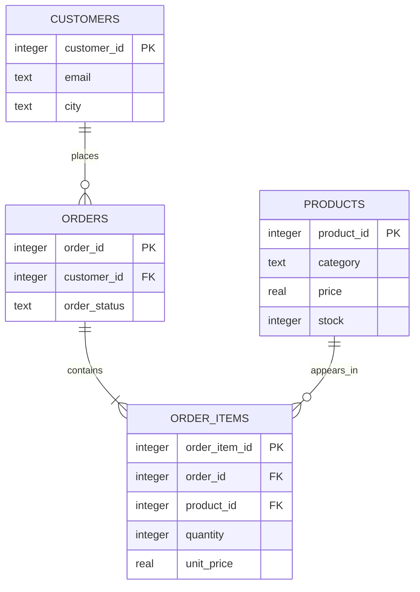

# E-Commerce SQL Analytics

**Relational database design and sales analytics using SQL and SQLite.**

This project models a small e-commerce dataset and demonstrates how relational queries can answer questions about customers, products, inventory, and sales.

## What it demonstrates

- Relational schema with customers, products, orders, and order items
- Primary keys, foreign keys, and data integrity constraints
- Joins, aggregate functions, subqueries, and CTEs
- Window functions such as `RANK()`
- Conditional logic with `CASE` and null handling with `COALESCE`
- Inventory and customer-spending analysis
- Product rankings by units sold and revenue
- Indexes on commonly filtered or joined columns

## Technology

SQLite · SQL · Git

## Schema overview

- `customers`: customer name, email, city, registration date
- `products`: product, category, price, and stock
- `orders`: customer, date, and order status
- `order_items`: product quantities and purchase-time unit price

One customer can place many orders. An order can contain many products through `order_items`; the stored unit price preserves the purchase price at order time.

## Entity relationships



## Run locally

Install SQLite and ensure `sqlite3` is available in your terminal.

```bash
git clone https://github.com/kirubanandhan016/ecommerce-sql-project.git
cd ecommerce-sql-project
sqlite3 ecommerce.db < ecommerce.sql
```

Open the database:

```bash
sqlite3 ecommerce.db
```

Use `.tables` to inspect tables and `.schema` to inspect their definitions.

**Note:** The setup script inserts fixed sample records. For a clean repeatable run, use a fresh database file; rerunning the script against an already populated database may trigger primary-key conflicts.

## Example questions

- Which products have low or zero stock?
- What is the sales revenue by product?
- Which customers have the highest completed-order spending?
- How do products rank within their categories by price?
- Which categories have the highest average product prices?

The SQL files contain the queries; execute them against the initialized database to inspect the results.

## Why this project is relevant to backend development

It demonstrates relational modeling, constraints, joins, aggregations, and query patterns commonly used by API services and reporting endpoints.

## Author

**Kirubanandhan V** · [GitHub](https://github.com/kirubanandhan016) · [Portfolio](https://kirubanandhan016.github.io/)


## Query review workflow

1. Create a fresh database using the setup script.
2. Inspect table definitions with `.schema` and verify foreign-key relationships.
3. Run each analytical query against the same sample dataset.
4. Compare aggregate results with small hand-calculated examples.
5. Use `EXPLAIN QUERY PLAN` before and after adding an index; retain an index only when it supports a real access pattern.

Use the stored `order_items.unit_price` for historical order revenue rather than the current product price. This preserves the price charged at the time of purchase.

